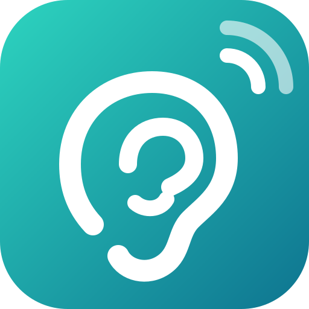
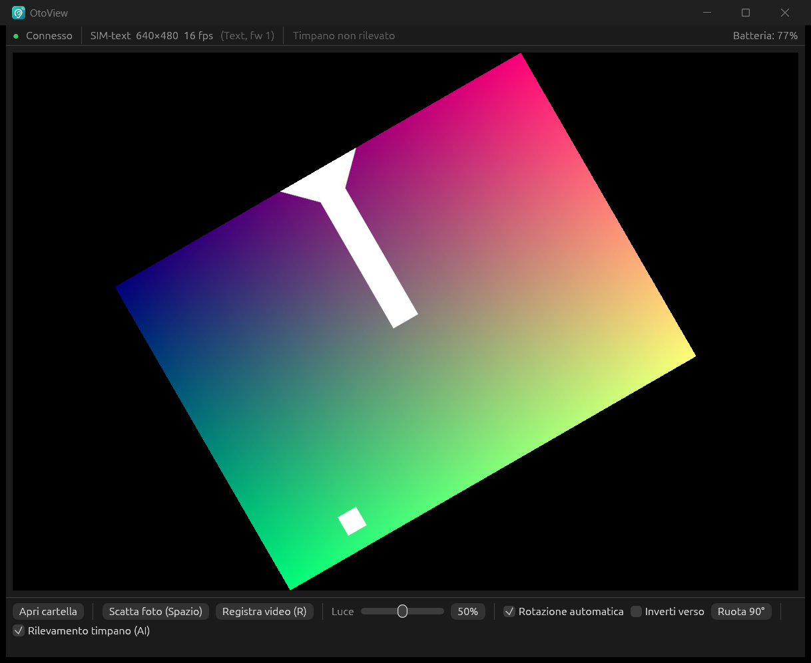
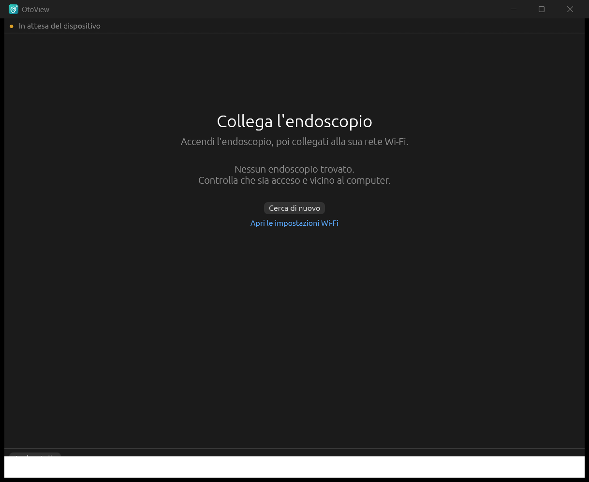

<p align="center">
  
</p>

<h1 align="center">OtoView</h1>

<p align="center">
  <b>App desktop open source per endoscopi auricolari Wi-Fi (otoscopi).</b><br>
  Video in diretta, foto, registrazione e riconoscimento del timpano sul computer, per Windows, macOS e Linux.
</p>

<p align="center">
  <a href="https://github.com/gianmarcobonan/otoview/actions/workflows/ci.yml"></a>
  <a href="https://github.com/gianmarcobonan/otoview/releases/latest"></a>
  <a href="https://github.com/gianmarcobonan/otoview/releases"></a>
  
  <a href="#licenza"></a>
</p>

<p align="center">
  <a href="#download">Download</a> •
  <a href="#funzioni">Funzioni</a> •
  <a href="#come-si-usa">Come si usa</a> •
  <a href="#dispositivi-supportati">Dispositivi</a> •
  <a href="#compilare-dai-sorgenti">Compilare</a> •
  <a href="#come-funziona">Come funziona</a> •
  <a href="README.md">🇬🇧 English</a>
</p>

<p align="center">
  
  
</p>
<p align="center"><sub>A sinistra: video in diretta (immagine di prova del simulatore integrato). A destra: collegamento con un clic.</sub></p>

> [!IMPORTANT]
> OtoView **non è un dispositivo medico** e non va usato per fare diagnosi. Leggi le [avvertenze](#avvertenze).

## Perché

Le telecamere auricolari Wi-Fi economiche (quelle "per la pulizia delle orecchie") hanno solo un'app per telefono.
OtoView permette di usarle dal computer: schermo grande, foto e video salvati direttamente su disco,
e **niente account, niente cloud, nessun dato inviato**. È un unico programma nativo: non serve installare nulla.

## Funzioni

- 📶 **Collegamento con un clic**: trova il Wi-Fi dell'endoscopio (`softish-xxxx`), ci si collega e alla fine ti riporta sul tuo Wi-Fi
- 🎥 **Video in diretta** da entrambe le famiglie di firmware conosciute
- 📷 **Foto** (<kbd>Spazio</kbd>) e 🎬 **video MP4** (<kbd>R</kbd>, H.264 tramite FFmpeg)
- ✨ **Miglioramento dell'immagine dal vivo** (<kbd>E</kbd>): fonde fotogrammi consecutivi allineandoli al movimento della mano, per meno rumore e quadretti JPEG e più dettaglio reale; non inventa nulla
- 🖼️ **Foto AI** (facoltative): ogni foto può avere anche una copia `-ai` ingrandita 2× da [Real-ESRGAN](https://github.com/xinntao/Real-ESRGAN) sulla scheda grafica; vedi [sotto](#foto-ai)
- 💡 **Regolazione della luce** e 🔋 **livello batteria** (anche in carica)
- 🔄 **Rotazione automatica** con il sensore di inclinazione del dispositivo, più rotazione manuale di 90°
- 🧠 **Riconoscimento del timpano (AI)**, eseguito sul computer in Rust puro ([tract](https://github.com/sonos/tract)); facoltativo, vedi [sotto](#riconoscimento-del-timpano-ai)
- 🛜 Funziona anche se il PC ha un cavo verso un router di casa che è anch'esso `192.168.1.1`
- 🌍 Italiano e inglese, scelti in base alla lingua del sistema
- 🔒 Completamente offline: l'app parla solo con l'endoscopio

## Download

Scarica l'ultima versione dalla [pagina Releases](https://github.com/gianmarcobonan/otoview/releases/latest).

| Sistema | File | Note |
|---|---|---|
| Windows 10/11 (x64) | `OtoView-windows-x64.zip` | Estrai e avvia `otoview.exe` |
| macOS 11+ (Intel e Apple Silicon) | `OtoView-macos-universal.zip` | Estrai e apri `OtoView.app` |
| Linux (x86_64) | `OtoView-linux-x86_64.AppImage` | `chmod +x` e avvia |

Ogni pacchetto è **portable** e contiene già FFmpeg per registrare i video.

## Come si usa

1. Scarica e avvia OtoView.
2. Accendi l'endoscopio.
3. Clicca **Connetti a softish-xxxx**. Il video compare da solo.
4. Scatta foto con <kbd>Spazio</kbd> e registra con <kbd>R</kbd>. I file vanno in `Immagini/OtoView`.
5. Quando hai finito, clicca **Torna a &lt;il tuo Wi-Fi&gt;** in alto per riavere internet.

<details>
<summary><b>Primo avvio sui vari sistemi</b></summary>

- **Windows**: quando il firewall lo chiede, consenti OtoView sulle *reti private*. Il video arriva via UDP.
- **macOS**: l'app non è ancora firmata, quindi la prima volta fai clic destro su `OtoView.app` → **Apri**.
  Poi consenti l'accesso alla **Rete locale** quando macOS lo chiede.
- **Linux**: il collegamento con un clic usa NetworkManager (`nmcli`), già presente nella maggior parte delle distribuzioni desktop.
  Senza, collegati alla rete `softish-xxxx` dal menu di sistema: OtoView trova il dispositivo da solo.

</details>

## Dispositivi supportati

OtoView funziona con gli endoscopi Wi-Fi supportati dall'app Android **Endscope Tool** (provata sulla versione 2.6.6):
il dispositivo crea una rete Wi-Fi aperta chiamata `softish-xxxx` e risponde all'indirizzo `192.168.1.1`.
Sono supportate entrambe le famiglie di firmware usate da questi dispositivi.

| Dispositivo | Nome Wi-Fi | Stato |
|---|---|---|
| *Il tuo dispositivo* | `softish-…` | [Apri una issue](https://github.com/gianmarcobonan/otoview/issues/new) con marca, modello e una foto della confezione |

Il tuo dispositivo non funziona? Avvia `otoview --sim text` per verificare che il sistema sia a posto,
poi apri una issue: log e una cattura Wireshark aiutano molto.

## Riconoscimento del timpano (AI)

OtoView può disegnare un riquadro attorno al timpano, come l'app originale.
La rete neurale appartiene al produttore del dispositivo, quindi **non è inclusa**. La fornisci tu, una volta sola:

1. Procurati l'APK di **Endscope Tool** (l'app Android del tuo dispositivo).
2. **Trascina il file `.apk` sulla finestra di OtoView.**

OtoView estrae il modello, lo verifica e ne conserva una copia
(`%APPDATA%\otoview` su Windows, `~/Library/Application Support/otoview` su macOS, `~/.local/share/otoview` su Linux).
Tutto gira sul tuo computer (circa 70 ms per fotogramma sulla CPU di un portatile): nessuna immagine esce dal PC.

## Foto AI

Spunta **Foto AI** e ogni foto salva anche una copia `-ai.jpg`, ingrandita 2× dalla rete Real-ESRGAN.
Lavora in sottofondo sulla scheda grafica (DirectML su Windows, CoreML su Apple Silicon, Vulkan su Linux),
altrimenti sul processore: circa 1–2 s per foto con una grafica integrata. Non disponibile sui Mac Intel.

> [!WARNING]
> Le reti di super-risoluzione **inventano dettagli plausibili**: nelle prove ha riscritto lettere che non riusciva a leggere.
> La copia `-ai` serve solo per guardare; la foto originale viene sempre salvata accanto.

Per il video dal vivo usa invece **Migliora** (<kbd>E</kbd>): combina solo ciò che la telecamera ha davvero ripreso.

## Compilare dai sorgenti

Serve [Rust](https://rustup.rs) 1.95 o più recente.

```bash
git clone https://github.com/gianmarcobonan/otoview
cd otoview
cargo run --release
```

Niente dispositivo a portata di mano? Il simulatore integrato parla entrambi i protocolli:

```bash
cargo run --release -- --sim text   # oppure --sim tx
cargo test
```

La prima compilazione scarica una build già pronta di ONNX Runtime (per le foto AI) tramite il crate `ort`.
Per registrare video serve `ffmpeg` accanto all'eseguibile o nel `PATH`.
Su Linux egui richiede i soliti pacchetti di sviluppo X11/Wayland
(su Debian/Ubuntu: `libxkbcommon-dev libgl1-mesa-dev libwayland-dev`).

## Come funziona

L'endoscopio è un piccolo access point Wi-Fi. OtoView ci parla via UDP:
un canale di controllo (informazioni, batteria, luce) e un canale video che trasporta ogni fotogramma JPEG diviso in più pacchetti.
Il protocollo completo, ricostruito per interoperabilità con un'analisi statica dell'app Android, è in [PROTOCOL.md](PROTOCOL.md) (in inglese).

| File | Ruolo |
|---|---|
| [`src/protocol.rs`](src/protocol.rs) | Comandi, risposte, ricostruzione dei JPEG, scelta della scheda di rete |
| [`src/wifi.rs`](src/wifi.rs) | Passaggio al Wi-Fi dell'endoscopio e ritorno (netsh / networksetup / nmcli) |
| [`src/app.rs`](src/app.rs) | Interfaccia grafica ([egui](https://github.com/emilk/egui)) |
| [`src/record.rs`](src/record.rs) | Registrazione MP4 tramite FFmpeg |
| [`src/enhance.rs`](src/enhance.rs) | Miglioramento dal vivo: allineamento dei fotogrammi, fusione che tiene conto del movimento, nitidezza |
| [`src/upscale.rs`](src/upscale.rs) | Foto AI: Real-ESRGAN con ONNX Runtime sulla scheda grafica |
| [`src/detect.rs`](src/detect.rs) | Riconoscimento del timpano: SSD-MobileNet con tract, più decodifica dei riquadri e NMS |
| [`src/sim.rs`](src/sim.rs) | Simulatore del dispositivo usato dai test |

## Contribuire

Segnalazioni di bug, dispositivi provati, traduzioni e pull request sono benvenuti.
Prima di aprire una pull request esegui `cargo test` e `cargo clippy`.

## Licenza

OtoView è distribuito con doppia licenza [MIT](LICENSE-MIT) o [Apache-2.0](LICENSE-APACHE), a tua scelta.
I pacchetti di rilascio contengono anche una build non modificata di [FFmpeg](https://ffmpeg.org), distribuita con la sua licenza (GPL),
il modello Real-ESRGAN (BSD-3-Clause) e ONNX Runtime (MIT): vedi [THIRD-PARTY-NOTICES.md](THIRD-PARTY-NOTICES.md).

## Avvertenze

OtoView è un progetto indipendente: **non è affiliato, approvato né collegato** ai produttori dei dispositivi
o dell'app Endscope Tool. Tutti i marchi appartengono ai rispettivi proprietari.
**Non è un dispositivo medico**: immagini e indicazioni dell'AI sono solo per uso personale, non diagnostico.
Non inserire nulla nell'orecchio senza un'adeguata preparazione; in caso di dubbio rivolgiti a un medico.
