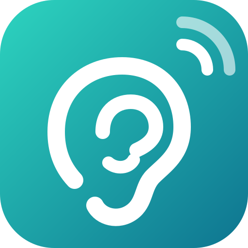
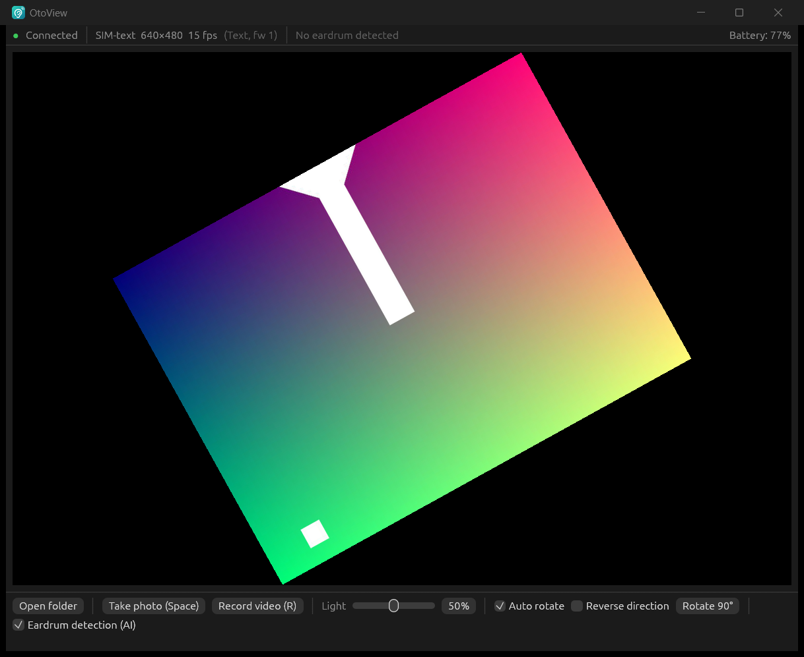
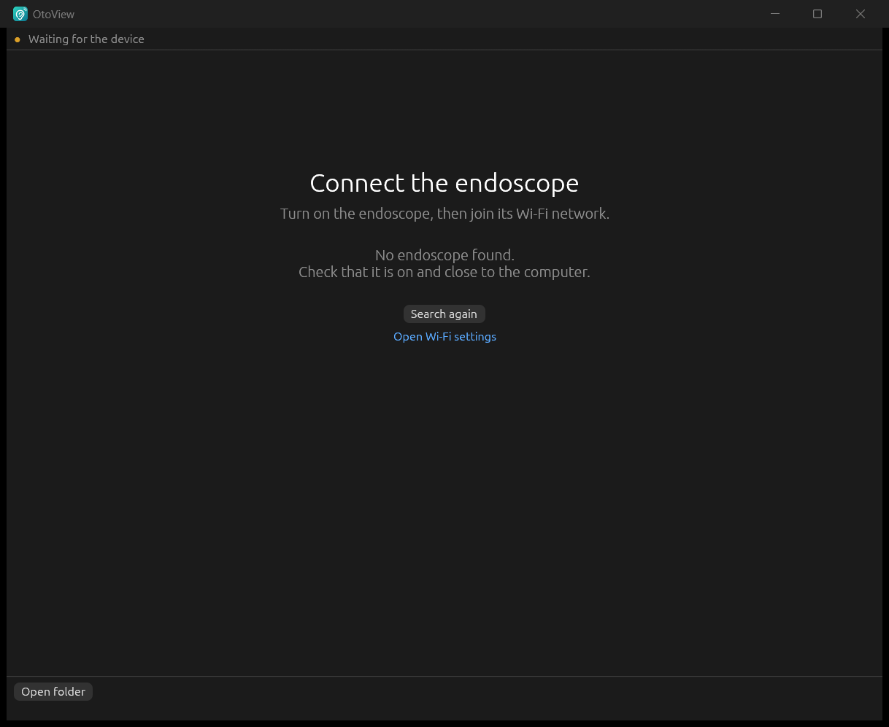

<p align="center">
  
</p>

<h1 align="center">OtoView</h1>

<p align="center">
  <b>Open-source desktop app for Wi-Fi ear endoscopes (otoscopes).</b><br>
  Live view, photos, video recording and on-device eardrum detection, on Windows, macOS and Linux.
</p>

<p align="center">
  <a href="https://github.com/gianmarcobonan/otoview/actions/workflows/ci.yml"></a>
  <a href="https://github.com/gianmarcobonan/otoview/releases/latest"></a>
  <a href="https://github.com/gianmarcobonan/otoview/releases"></a>
  
  <a href="#license"></a>
</p>

<p align="center">
  <a href="#download">Download</a> •
  <a href="#features">Features</a> •
  <a href="#quick-start">Quick start</a> •
  <a href="#supported-devices">Devices</a> •
  <a href="#build-from-source">Build</a> •
  <a href="#how-it-works">How it works</a> •
  <a href="README-it.md">🇮🇹 Italiano</a>
</p>

<p align="center">
  
  
</p>
<p align="center"><sub>Left: live view (built-in simulator test pattern). Right: one-click connection screen.</sub></p>

> [!IMPORTANT]
> OtoView is **not a medical device** and must not be used for diagnosis. See the [disclaimer](#disclaimer).

## Why

Cheap Wi-Fi ear cameras (the "ear wax removal" kind) only come with a phone app.
OtoView lets you use them on a computer: a big screen, photos and videos saved straight to disk,
and **no account, no cloud, no telemetry**. It is a single native program; nothing to install.

## Features

- 📶 **One-click connection**: finds the endoscope's Wi-Fi (`softish-xxxx`), joins it, and takes you back to your own Wi-Fi when you are done
- 🎥 **Live video** from both known firmware families, with automatic reassembly of the UDP stream
- 📷 **Photos** (<kbd>Space</kbd>) and 🎬 **MP4 video** (<kbd>R</kbd>, H.264 via FFmpeg)
- ✨ **Live image enhancement** (<kbd>E</kbd>): merges consecutive frames aligned to your hand's motion, for less noise and JPEG blockiness and more real detail; nothing is invented
- 🖼️ **AI photos** (optional): each photo can also get an `-ai` copy enlarged 2× by [Real-ESRGAN](https://github.com/xinntao/Real-ESRGAN) on your GPU; see [below](#ai-photos)
- 💡 **Light control** and 🔋 **battery level** (including charging)
- 🔄 **Auto-rotation** from the device's G-sensor, plus manual 90° rotation
- 🧠 **Eardrum detection (AI)**, running locally in pure Rust ([tract](https://github.com/sonos/tract)); opt-in, see [below](#ai-eardrum-detection)
- 🛜 Works even when your PC also has a cable to a home router that is also `192.168.1.1`
- 🌍 English and Italian, chosen from the system language
- 🔒 Fully offline: the app only talks to the endoscope

## Download

Get the latest version from the [Releases page](https://github.com/gianmarcobonan/otoview/releases/latest).

| System | File | Notes |
|---|---|---|
| Windows 10/11 (x64) | `OtoView-windows-x64.zip` | Unzip and run `otoview.exe` |
| macOS 11+ (Intel and Apple Silicon) | `OtoView-macos-universal.zip` | Unzip and open `OtoView.app` |
| Linux (x86_64), Ubuntu 24.04+ or equivalent (glibc 2.38+) | `OtoView-linux-x86_64.AppImage` | `chmod +x` and run |

Every package is **portable** and already contains FFmpeg for video recording.

## Quick start

1. Download and start OtoView.
2. Turn on the endoscope.
3. Click **Connect to softish-xxxx**. The video appears by itself.
4. Take photos with <kbd>Space</kbd> and record with <kbd>R</kbd>. Files go to `Pictures/OtoView`.
5. When you are done, click **Back to &lt;your Wi-Fi&gt;** at the top to get your internet back.

<details>
<summary><b>First run on each system</b></summary>

- **Windows**: when the firewall asks, allow OtoView on *private networks*. The video arrives over UDP.
- **macOS**: the app is not signed yet, so right-click `OtoView.app` → **Open** the first time.
  Then allow **Local Network** access when macOS asks.
- **Linux**: one-click connection uses NetworkManager (`nmcli`), which most desktop distributions already have.
  Without it, join the `softish-xxxx` network from your system menu; OtoView finds the device by itself.

</details>

## Supported devices

OtoView works with the Wi-Fi endoscopes supported by the **Endscope Tool** Android app (tested against version 2.6.6):
the device creates an open Wi-Fi network named `softish-xxxx` and answers at `192.168.1.1`.
Both firmware families used by these devices are supported.

| Device | Wi-Fi name | Status |
|---|---|---|
| *Your device here* | `softish-…` | Please [open an issue](https://github.com/gianmarcobonan/otoview/issues/new) with the brand, model and a photo of the box |

Have a device that does not work? Run `otoview --sim text` to check that your system is fine,
then open an issue: logs and a Wireshark capture help a lot.

## AI eardrum detection

OtoView can show a box around the eardrum, like the original app.
The neural network belongs to the device maker, so **it is not included**. You supply it once:

1. Get the **Endscope Tool** APK (the Android app that came with your device).
2. **Drag the `.apk` file onto the OtoView window.**

OtoView extracts the model, checks it, and keeps a copy for next time
(`%APPDATA%\otoview` on Windows, `~/Library/Application Support/otoview` on macOS, `~/.local/share/otoview` on Linux).
Everything runs on your computer (about 70 ms per frame on a laptop CPU); no image ever leaves it.

## AI photos

Tick **AI photos** and every photo also saves an `-ai.jpg` copy, enlarged 2× by the Real-ESRGAN network.
It runs in the background on your graphics card (DirectML on Windows, CoreML on Apple Silicon, Vulkan on Linux),
or on the CPU otherwise: about 1–2 s per photo on integrated graphics. Not available on Intel Macs.

> [!WARNING]
> Super-resolution networks **invent plausible detail**: in tests it rewrote letters it could not read.
> The `-ai` copy is for viewing only; the original photo is always saved next to it.

For the live view, use **Enhance** (<kbd>E</kbd>) instead: it only combines what the camera really captured.

## Build from source

You need [Rust](https://rustup.rs) 1.95 or newer.

```bash
git clone https://github.com/gianmarcobonan/otoview
cd otoview
cargo run --release
```

No device at hand? A built-in simulator speaks both firmware protocols:

```bash
cargo run --release -- --sim text   # or --sim tx
cargo test
```

The first build downloads a prebuilt ONNX Runtime (for AI photos) through the `ort` crate.
Video recording needs `ffmpeg` next to the executable or on your `PATH`.
On Linux, egui needs the usual X11/Wayland development packages
(on Debian/Ubuntu: `libxkbcommon-dev libgl1-mesa-dev libwayland-dev`).

## How it works

The endoscope is a small Wi-Fi access point. OtoView talks to it over UDP:
a control channel (info, battery, light) and a video channel that carries each JPEG frame split into datagrams.
The full protocol, written up from a static analysis of the Android app for interoperability, is in [PROTOCOL.md](PROTOCOL.md).

| File | Role |
|---|---|
| [`src/protocol.rs`](src/protocol.rs) | Commands, replies, JPEG reassembly, network adapter selection |
| [`src/wifi.rs`](src/wifi.rs) | Joining the endoscope Wi-Fi and back (netsh / networksetup / nmcli) |
| [`src/app.rs`](src/app.rs) | User interface ([egui](https://github.com/emilk/egui)) |
| [`src/record.rs`](src/record.rs) | MP4 recording through FFmpeg |
| [`src/enhance.rs`](src/enhance.rs) | Live enhancement: frame alignment, motion-aware fusion, detail sharpening |
| [`src/upscale.rs`](src/upscale.rs) | AI photos: Real-ESRGAN through ONNX Runtime on the GPU |
| [`src/detect.rs`](src/detect.rs) | Eardrum detector: SSD-MobileNet with tract, plus box decoding and NMS |
| [`src/sim.rs`](src/sim.rs) | Device simulator used by the tests |

## Contributing

Bug reports, tested devices, translations and pull requests are welcome.
Please run `cargo test` and `cargo clippy` before opening a pull request.

## License

OtoView is dual-licensed under [MIT](LICENSE-MIT) or [Apache-2.0](LICENSE-APACHE), at your option.
The release packages also contain an unmodified [FFmpeg](https://ffmpeg.org) build, distributed under its own license (GPL),
the Real-ESRGAN model (BSD-3-Clause) and ONNX Runtime (MIT): see [THIRD-PARTY-NOTICES.md](THIRD-PARTY-NOTICES.md).

## Disclaimer

OtoView is an independent project. It is **not affiliated with, endorsed by, or connected to** the makers of the devices
or of the Endscope Tool app; all trademarks belong to their owners.
It is **not a medical device**: images and AI hints are for personal, non-diagnostic use only.
Do not insert anything into the ear without proper training; if in doubt, see a doctor.
